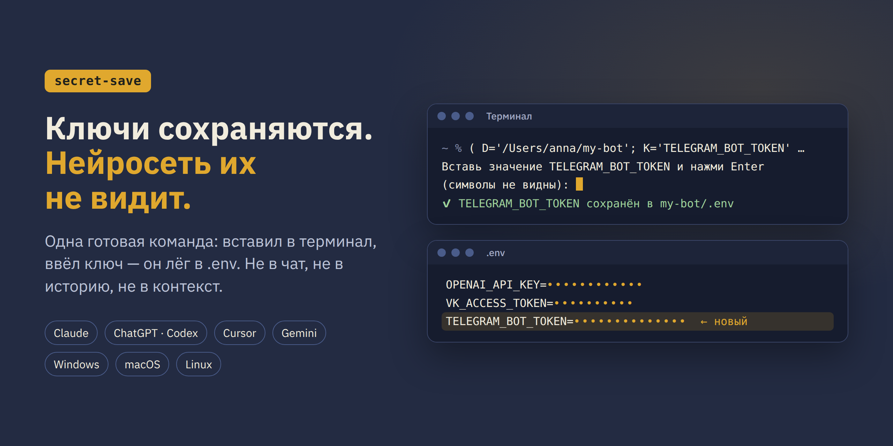

<p align="center">
  
</p>

<h1 align="center">secret-save</h1>

<p align="center">
  <b>Скилл для нейросети: пароли, API-ключи и токены сохраняются в <code>.env</code>, а сама нейросеть их не видит.</b><br/>
  Одна готовая команда — вставил в терминал, ввёл ключ, готово. Claude, ChatGPT/Codex, Cursor, Gemini · Windows, macOS, Linux.
</p>

<p align="center">
  <a href="#-установка-одной-фразой"></a>
  <a href="https://t.me/sipita08"></a>
  <a href="https://sipita.ru/"></a>
  <a href="https://t.me/sipita08"></a>
</p>

<p align="center">
  
  
  
  
  
  
  
  
</p>

---

## Зачем это

Подключаешь к нейросети Telegram-бота, ВКонтакте, календарь, GitHub или другую нейросеть по
API — и сервис выдаёт ключ. Дальше два плохих варианта.

**Вставить ключ в чат.** Ключ остаётся в переписке, в логах и в контексте всего, что работает в
этой сессии, включая чужие скиллы и программы. Отдал ключ — отдал доступ к боту, календарю,
деньгам на балансе.

**Сохранить «правильно» — через терминал.** Нейросеть даёт команду, в которую надо самому
вписать ключ. Куда именно вписать? В какой терминал вставлять — на ноутбуке, в программе, на
сервере? Вставил — не сработало, или сработало, но ключ лёг не туда. Для человека, который не
программист, это час мучений на ровном месте.

**secret-save убирает обе проблемы:**

- нейросеть готовит **одну команду**, которую не нужно редактировать — только скопировать;
- команда сама просит ключ, ввод **скрыт**, как пароль;
- ключ ложится в `.env` проекта — **все ключи в одном месте**, нейросеть знает, где какой, а тебе
  не нужно помнить их и вставлять каждый раз заново;
- команда **сама проверяет**, что её вставили на нужном компьютере, а если нет — объясняет
  словами, куда вставить;
- нейросеть проверяет, что ключ сохранился, **не читая его**. Посмотреть значение можешь только ты
  сам — это твой файл.

## Как это выглядит

> **Ты:** сохрани токен моего Telegram-бота
>
> **Нейросеть:** Сохраню ключ как `TELEGRAM_BOT_TOKEN` в `/Users/anna/my-bot/.env`. Скопируй
> команду, вставь в терминал и нажми Enter. Когда попросит значение — вставь ключ и снова Enter.

```text
Вставь значение TELEGRAM_BOT_TOKEN и нажми Enter (символы не видны):
✅ TELEGRAM_BOT_TOKEN сохранён в /Users/anna/my-bot/.env
```

> **Ты:** готово
>
> **Нейросеть:** Ключ на месте. Значения я не видел — и не увижу.

<!-- ВИДЕО: когда выйдет обзор, вставить сюда
## 🎬 Видео-обзор
[](https://youtu.be/ID_ВИДЕО)
-->

## ⚡ Установка одной фразой

Скопируй и отправь своей нейросети (Claude Code, Codex, Cursor, Gemini CLI — любой, у которой
есть доступ к твоему компьютеру):

```text
Установи скилл secret-save из https://github.com/Sipita-Sergey/secret-save — инструкция для тебя в файле INSTALL.md. Поставь глобально, чтобы работал во всех проектах, и скажи, когда готово.
```

Нейросеть сама скачает скилл и положит его туда, где она ищет скиллы.

<details>
<summary><b>Поставить вручную</b></summary>

Одной командой для всех нейросетей на компьютере (нужен Node.js):

```bash
npx skills add Sipita-Sergey/secret-save -g -y
```

Или скопируй папку `skills/secret-save` сюда:

| Нейросеть | Папка |
|---|---|
| Claude Code | `~/.claude/skills/secret-save/` |
| OpenAI Codex | `~/.agents/skills/secret-save/` |
| Cursor | `~/.cursor/skills/secret-save/` |
| Gemini CLI | `~/.gemini/skills/secret-save/` |
| GitHub Copilot (VS Code) | `~/.copilot/skills/secret-save/` |

На Windows `~` — это `C:\Users\<имя>`.

**Claude или ChatGPT в браузере, в приложении, на телефоне:** скачай архив
https://github.com/Sipita-Sergey/secret-save/releases/download/latest/secret-save.zip и загрузи
его в «Навыки» (в Claude: «Настроить» → «Навыки» → «+»; в ChatGPT: «Плагины» → «Навыки» → «+»). Раздела
«Навыки» нет — положи тот же архив в файлы проекта. Проще всего — отправь нейронке ссылку на
[INSTALL.md](INSTALL.md), она проведёт сама.

</details>

## Обновления

Скилл сам следит за новыми версиями: в начале работы нейросеть сверяет свою версию с этим
репозиторием и, если вышла новая, прежде чем запускать скилл, скажет тебе об этом и спросит:
обновить сейчас или продолжить на текущей. Без твоего «да» ничего не меняется. Что нового — в [CHANGELOG](CHANGELOG.md).

## Как пользоваться

Ничего запоминать не нужно — скажи нейросети своими словами:

- «сохрани ключ OpenAI»
- «вот токен бота, сохрани» — нейросеть остановит и даст команду, чтобы ключ не ушёл в чат
- «замени ключ от ВКонтакте» — та же команда перезапишет старое значение

## Проверено

| Где | Результат |
|---|---|
| macOS, zsh | ✅ прогон в настоящем терминале |
| Linux, bash | ✅ |
| PowerShell 7 | ✅ |
| Windows PowerShell 5.1 (встроенный в Windows) | та же логика, живьём на Windows пока не прогонялось — пишите, если что-то не так |

Что проверялось: ключ сохраняется символ в символ (кириллица, кавычки, `$`, `#`, обратные
слеши), остальные ключи в файле не трогаются, старое значение заменяется, лишний Enter не
выбрасывает из команды, вставка не на том компьютере ничего не пишет и объясняет, что делать.

## Что внутри

```text
secret-save/
├── skills/secret-save/
│   ├── SKILL.md                  ← сам скилл: правила для нейросети и команды
│   ├── VERSION                   ← номер версии
│   └── scripts/check-update.*    ← проверка новой версии (sh и PowerShell)
├── CHANGELOG.md                  ← что менялось от версии к версии
├── INSTALL.md                    ← инструкция установки для нейросети
├── AGENTS.md                     ← короткая заметка для агентов, открывших репозиторий
└── assets/                       ← баннер
```

## 🤝 Автор и поддержка

Сделал **Сергей Сипита** — внедряю ИИ в маркетинг и собираю AI-офисы: команды цифровых
сотрудников, которые ведут дела за предпринимателя. Этот скилл — из моего рабочего офиса,
пользуюсь им каждый день.

- 🌐 Сайт — https://sipita.ru/ — нейроофисы для предпринимателей и специалистов
- 📣 Telegram-канал — https://t.me/sipita08 — поддержка, вопросы и новые версии скилла
- 🤖 Бот со скиллами — https://t.me/sipita_sergey_bot — забрать скиллы и материалы
- 🌐 ВКонтакте — https://vk.ru/sipita08
- 🐞 Нашли ошибку или есть идея — [Issues](https://github.com/Sipita-Sergey/secret-save/issues)

Если скилл пригодился — поставь ⭐, так его найдут другие.

---

<p align="center">
  <b>secret-save</b> · <a href="LICENSE">MIT</a> · <a href="https://sipita.ru/">sipita.ru</a> · <a href="https://t.me/sipita08">Telegram</a> · <a href="INSTALL.md">Установка для нейросети</a>
</p>
